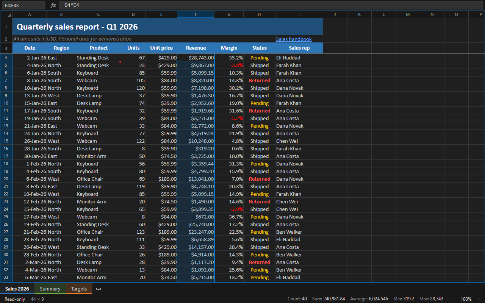
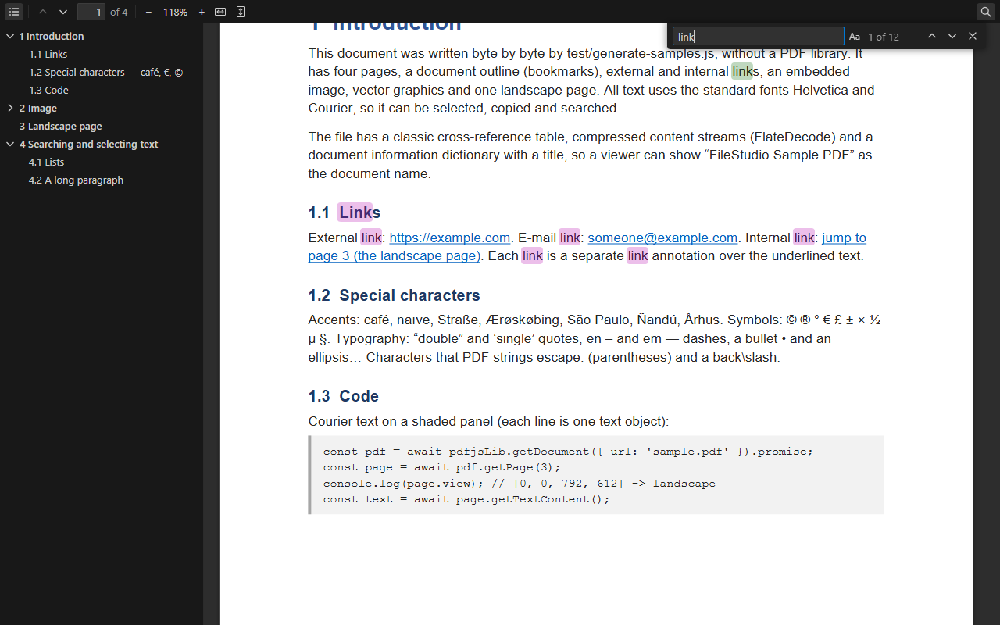
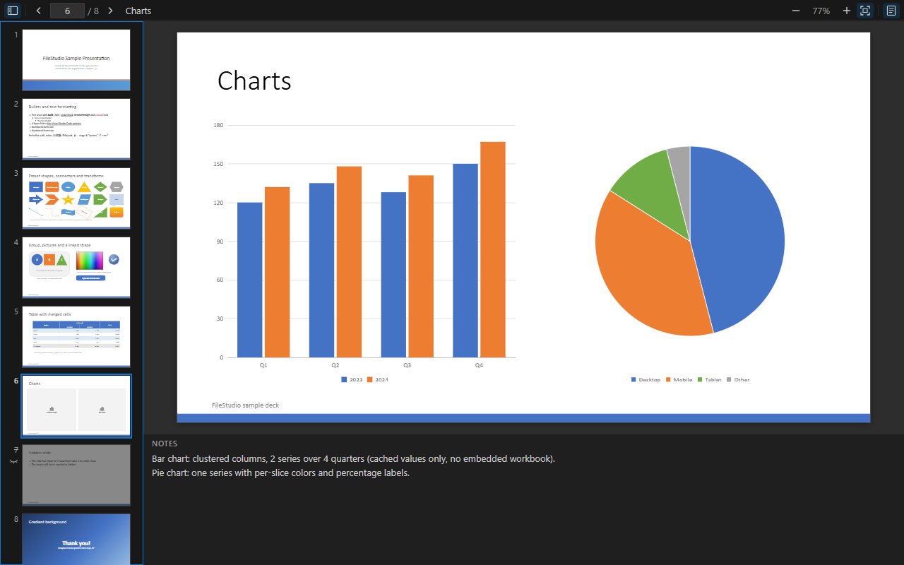

# FileStudio – Excel, CSV, Word, PDF & PowerPoint Viewer for VS Code

**Open `.xlsx`, `.csv`, `.docx`, `.pdf`, `.pptx` and `.md` files right inside VS Code, and edit Excel and Markdown files.**
No Microsoft Office, no LibreOffice, no browser: click the file and work with it next to your code.

⚡ Fast · 🔒 Offline and private · 🎨 Follows your VS Code theme · ⌨️ Keyboard and screen-reader friendly

---

## 📂 Supported files

| | Format | File types | |
| --- | --- | --- | --- |
| 📊 | **Excel spreadsheets** | `.xlsx` | view and edit |
| 🧾 | **CSV and delimited text** | `.csv` `.tsv` `.psv` `.ssv` | view |
| 📄 | **Word documents** | `.docx` | view |
| 📕 | **PDF documents** | `.pdf` | view |
| 📽️ | **PowerPoint presentations** | `.pptx` `.pptm` `.ppsx` `.ppsm` `.potx` `.potm` | view |
| 📝 | **Markdown** | `.md` `.markdown` | view and edit |

> **New in 0.2.0: editing.** Change cells in `.xlsx` workbooks, and edit Markdown in a WYSIWYG view.

## ✨ Features

### 📊 Excel / XLSX viewer and editor
- Excel-like grid with the workbook's **fonts, colours, borders, number formats** and merged cells.
- **Sheet tabs**, frozen panes, hidden rows, columns and sheets, comments and links.
- **Formula bar** and status bar with **Sum, Average, Count, Min and Max**, as in Excel.
- Copy cells and paste them into Excel. Smooth scrolling, even with **100,000 rows**.
- **Edit cells:** type to start, F2 or double-click to edit in the cell, or edit in the formula bar. Enter, Tab and
  Esc work as in Excel, Delete clears, and you can paste a block from Excel or a text table.
- Numbers, dates, percentages, `TRUE` / `FALSE` and formulas (`=SUM(A1:A3)`) are understood.
- **Undo, Redo, Save and Revert** work as in any VS Code editor. One action is one undo step.
- **Safe saving:** only the edited cells change in the file. Charts, pivot tables, comments and other content stay
  as they are. The new file is checked before it is written. The first save keeps a copy as `<name>.xlsx.bak`.

### 🧾 CSV / TSV viewer
- Comma, semicolon, tab, pipe or space: the **delimiter is detected automatically** (Excel's `sep=` line too).
- Stays in sync while you edit the file as text. **FileStudio: Change Delimiter** picks another one.

### 📄 Word / DOCX viewer
- Clean reading view with headings, lists, **tables, images** and links.

### 📕 PDF viewer
- **Zoom**, fit width or page, page navigation, **outline** (bookmarks) and **Find** (Ctrl+F, F3).
- Selectable, copyable text and clickable links.

### 📽️ PowerPoint / PPTX viewer
- **Slides** with text, shapes, pictures, **tables and charts**.
- Slide thumbnails, **speaker notes** and hidden slides.

### 📝 Markdown preview and editor
- GitHub-style preview with **math (KaTeX)**, **Mermaid diagrams**, code highlighting and clickable task lists.
- Three modes in the toolbar: **Preview**, **Split** (VS Code's text editor beside the preview, scrolling in step)
  and **WYSIWYG** (edit the formatted document directly).
- WYSIWYG writes back only the parts you change. Line endings, spaces and everything you did not touch stay as
  they were.
- In the WYSIWYG editor, **Tab** stays in the editor. Press **Esc** (or **Shift+Tab**) to move focus out of it.
- A **table of contents** panel: click a heading to jump to it.

### 🔀 Works with Git
- **Open Changes** shows the old and the new version of a workbook, document, PDF or presentation side by side.

  
  

## 🚀 Getting started

1. Install **FileStudio** from the Extensions view (search for *FileStudio*, *Excel viewer* or *PDF viewer*).
2. **Click any supported file.** It opens in FileStudio.
3. Markdown opens as text by default: right-click it → **Open with FileStudio**. The **Reopen as Text** button in
   the editor title bar shows the raw text of a CSV or Markdown file.

Requires VS Code 1.123 or later. If you used the earlier **File Viewer** extension (`Yokeeswaran.file-viewer`),
uninstall it, so that it does not open the files instead of FileStudio.

## ✏️ Editing

### Settings

| Setting | Default | What it does |
| --- | --- | --- |
| **FileStudio > Editing: Enabled** (`fileStudio.editing.enabled`) | on | Turn off to make every FileStudio view read-only. |
| **FileStudio > Xlsx: Editing** (`fileStudio.xlsx.editing`) | on | Editing of `.xlsx` workbooks. |
| **FileStudio > Markdown: Editing** (`fileStudio.markdown.editing`) | on | WYSIWYG editing and task checkboxes in Markdown. |
| **FileStudio > Markdown: Default Mode** (`fileStudio.markdown.defaultMode`) | Preview | The mode a Markdown file opens in. |
| **FileStudio > Xlsx: Backup On Save** (`fileStudio.xlsx.backupOnSave`) | on | Copy the file to `<name>.xlsx.bak` before the first save. An existing `.bak` is never replaced. |

### When a workbook is read-only

A workbook opens read-only (you can view, scroll and copy) when:
- editing is turned off in the settings,
- VS Code treats the file as read-only: for example a Git version in **Open Changes**, or a file matched by the
  **Files: Readonly Include** setting,
- the workbook is too large: more than about **100,000 cells** (used rows x columns of all sheets), or sheets,
  strings and styles that unpack to more than **25 MB** (pictures do not count). A banner says so.
- FileStudio cannot save the file safely, for example a Strict Open XML or ZIP64 file, or a damaged file. A banner
  gives the reason.

A workbook with content FileStudio cannot update (for example charts, pivot tables or external links) asks
**Edit anyway** first. That content is kept as it is.

Some cells are never changed, and FileStudio says why: the header or totals row of a table, array formulas, some
shared formulas, merged blocks that a paste does not fit, and cells on a protected sheet.

A Markdown file that cannot be edited without risk opens read-only, with a short reason.

## ❓ FAQ

**How do I open an Excel (`.xlsx`) file in VS Code?**
Install FileStudio and click the file. The workbook opens in a spreadsheet grid.

**Can I view PDF, Word (`.docx`) and PowerPoint (`.pptx`) files in VS Code?**
Yes, all three open in FileStudio, without Microsoft Office.

**Does it open the old `.doc`, `.xls` or `.ppt` formats?**
Not yet. Save them as `.docx`, `.xlsx` or `.pptx` first.

**Can I edit the files?**
Yes, from 0.2.0: cells in `.xlsx` workbooks, and Markdown files (WYSIWYG mode and task checkboxes; Split mode uses
VS Code's own text editor). CSV, Word, PDF and PowerPoint files are view-only in FileStudio. To change a CSV file,
use **Reopen as Text**.

**Will saving change parts of my workbook that I did not edit?**
No. FileStudio changes only the cells you edited. The new file is checked before it is written, and it is never left
half-written. The first save keeps a copy of the original as `<name>.xlsx.bak`.

**Why are my formulas not calculated?**
FileStudio does not calculate formulas. A formula you type shows no result, and formulas that use an edited cell can
show their old result. Excel calculates the whole workbook the next time you open the file.

**How do I turn editing off?**
Turn off **FileStudio > Editing: Enabled** in the settings, or the setting for one format (see **Editing** above).

**Is my file uploaded anywhere?**
No. Everything runs on your computer: no telemetry, no uploads. Links open only when you click them.

## ⚠️ Known limitations

- Very large `.xlsx` files take a while to open. In this version, a workbook with more than about 100,000 cells or a
  file whose sheets, strings and styles unpack to more than 25 MB opens read-only (pictures do not count). You can
  view and copy, but not edit. Editing large files comes in a later version.
- FileStudio does not calculate formulas (see the FAQ).
- In `.xlsx`, you can change cell values and formulas only: not rows, columns, sheets or cell formatting.
- Cut (Ctrl+X) is not available in the grid: use Copy and then Delete.
- If you close a tab while a cell is still open for typing, the text in that cell is not kept. Press Enter first.
- Very large Markdown files are slow to open in WYSIWYG mode (a Loading message with a percentage is shown while the
  editor is built). WYSIWYG is turned off above 200,000 characters, 3,000 blocks, or a weight of 10,000 points (a
  paragraph counts 1, a table row about 1.5, a list line 1): use Split for those. Above about 1,500 points the editor
  uses the browser's own text caret and shows no drop line when you drag a block, to keep typing fast.
- In Markdown WYSIWYG mode, a file whose line breaks are only carriage returns (old Mac-style files) cannot be edited:
  the change is refused ("could not read this change") and nothing is written. Use Split.
- In Markdown WYSIWYG mode, raw HTML, front matter and some special blocks are shown as protected blocks. You edit
  them as plain Markdown text.
- Charts and pivot tables in `.xlsx`, and video and animations in `.pptx`, are not shown yet.
- `.docx` shows the content, not the exact Word page layout.

See the [issues](https://github.com/yokeeswaran-dev/vscode-filestudio/issues) for more, or to report a bug.

## 🗺️ Roadmap

**0.1.x** viewer fixes · **0.2.0** editing · **1.0.0** stable

- **0.2.0:** edit cells in spreadsheets (`.xlsx`) and edit Markdown. CSV, Word, PDF and PowerPoint files stay
  view-only.
- **Under consideration:** edit CSV and other delimited files in the grid; insert and delete rows, columns and sheets,
  and change cell formatting in `.xlsx`; formula calculation. There is no date for these.
- **Next (planned):** fill PDF forms and add notes to PDF pages; change text and table cells in Word files and add
  comments; change slide text and speaker notes in PowerPoint files, hide slides and change their order.
- **Later:** rotate, delete and reorder PDF pages; track changes in Word files; delete and copy slides.
- **Not planned:** layout and design editing (fonts, images, page setup). Use Word, PowerPoint or a PDF editor for that.
- **Safety first:** FileStudio changes only the parts of a file that you edit, checks the new file before it saves,
  and keeps a backup. Encrypted, digitally signed or damaged files, and PDF forms with scripts, stay view-only.

## 🤝 Contributing & license

Contributions are welcome: see [CONTRIBUTING.md](CONTRIBUTING.md).
Released under the [MIT License](LICENSE). Third-party licences: [THIRD_PARTY_NOTICES.md](THIRD_PARTY_NOTICES.md).

Microsoft, Excel, Word and PowerPoint are trademarks of Microsoft Corporation. FileStudio is an independent
open-source project and is not affiliated with Microsoft.
